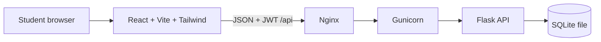

# PeerLearn

PeerLearn is a small peer-to-peer learning exchange for a college campus. Students list skills they can teach and want to learn, discover classmates, request study sessions, and leave feedback after a session.

## Features

- Email/password registration with Werkzeug password hashing and JWT authentication.
- Student profile with department, year, availability, and teach/learn skills.
- Rule-based recommendations that favor mutual skill exchanges, then availability overlap and department matches.
- Session request, accept/reject, cancel, and complete lifecycle with participant permissions.
- One 1–5 star review per participant after a completed session.
- React dashboard, partner search, sessions, and learning history.

## Architecture



The API runs on port 8000 behind Nginx on port 80. SQLite's path is configured with `DATABASE_PATH`; `JWT_SECRET` should be set outside source control.

## Run locally

Requirements: Python 3.11+, Node.js 20+, npm. From the repository root:

```bash
python3 -m venv backend/.venv
source backend/.venv/bin/activate
pip install -r backend/requirements.txt
export JWT_SECRET="$(python3 -c 'import secrets; print(secrets.token_hex(32))')"
export DATABASE_PATH="$PWD/backend/peerlearn.db"
python backend/app.py
```

In a second terminal:

```bash
cd frontend
npm ci
npm run dev
```

Open the Vite URL printed in the terminal. Its `/api` requests are proxied to Flask on port 5000. The Flask development server creates the tables at startup. Optionally seed demo records in a third terminal with the same `JWT_SECRET` and `DATABASE_PATH`:

```bash
cd backend
python seed.py
```

The seed command prints a one-time generated password for newly created demo accounts. If those accounts already exist, their passwords remain unchanged.

## Tests and integration smoke test

```bash
cd backend && pytest -q --cov=matching --cov=app
cd ../frontend && npm test && npm run build
cd .. && bash scripts/smoke_test.sh
```

See [docs/TESTING.md](docs/TESTING.md) for test coverage and [docs/DEPLOYMENT.md](docs/DEPLOYMENT.md) for Azure and Jenkins setup.
