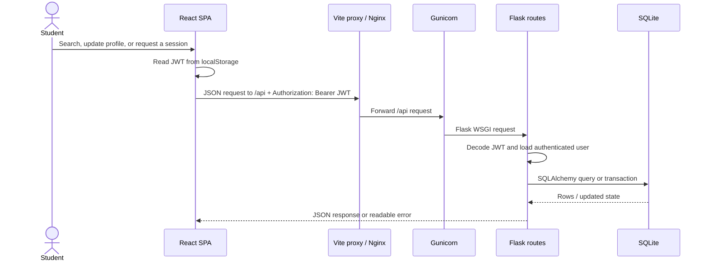
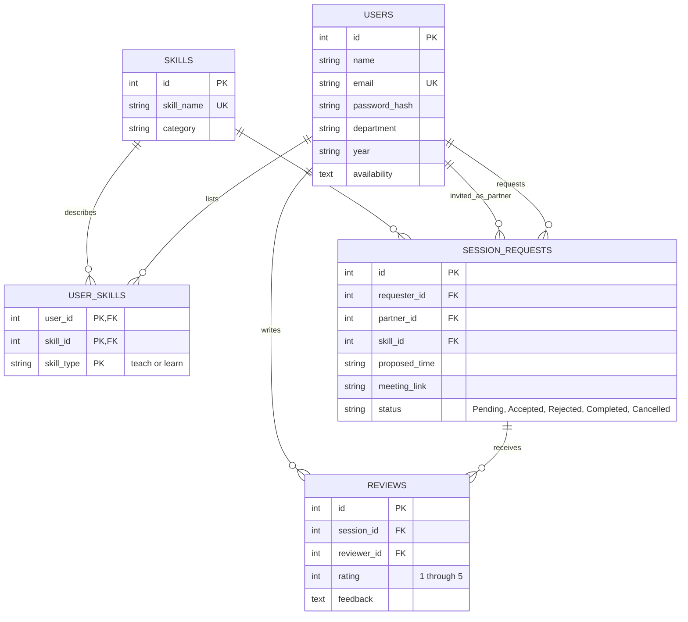

# Architecture

## Components and request flow

The React application uses `frontend/src/api/client.js` for JSON requests to the fixed `/api` base path. It adds the locally stored JWT as a Bearer token. Vite proxies `/api` to Flask on port 5000 during local development. In production, Nginx serves `frontend/dist` from `/var/www/peerlearn`, applies the SPA fallback, and reverse proxies `/api/` to Gunicorn on `127.0.0.1:8000`. Gunicorn runs the Flask app as the `peerlearn` Linux user under systemd. Flask validates the bearer token before protected routes, SQLAlchemy performs data access, and SQLite stores data outside the app source tree.

The matching algorithm chooses users who teach the requested skill, excludes the requester, optionally filters department, then scores mutual exchanges (+3), shared availability slots (+1 each), and same department (+1). It returns a `Mutual Exchange` or `Skill Match` badge and a stable score ordering.

## Database schema

The `user_skills` table has a composite key `(user_id, skill_id, skill_type)` so a student may both teach and learn the same skill. Reviews are unique per `(session_id, reviewer_id)`. Availability is stored as comma-separated text and serialized by the API as a list. `db.create_all()` creates missing tables but does not migrate changed columns; a future schema evolution needs a migration tool.

## CI/CD flow

```mermaid
flowchart LR
  Push[GitHub push to main] --> Hook[GitHub push webhook]
  Poll[Poll SCM every two minutes] --> Jenkins[Jenkins declarative pipeline]
  Hook --> Jenkins
  Jenkins --> Checkout[Checkout]
  Checkout --> Pytest[Backend venv, install, pytest]
  Pytest --> Vitest[Frontend npm ci, Vitest, Vite build]
  Vitest --> Package[Tar backend + frontend/dist + deploy files]
  Package --> SSH[SSH/SCP with azure-vm-ssh]
  SSH --> Deploy[deploy.sh on Azure VM]
  Deploy --> Nginx[Nginx serves SPA / proxies API]
  Nginx --> Gunicorn[Gunicorn systemd service]
  Gunicorn --> SQLite[(SQLite at /var/lib/peerlearn/peerlearn.db)]
  Deploy --> Verify[curl /api/health with retries]
```

Deploy and Verify stages run only on `main`; other branches can still test and package. `VM_HOST` is the public IP or DNS name used by the health check. `VM_SSH_HOST` may be `127.0.0.1` when Jenkins shares the VM to avoid public-IP hairpin routing. The private SSH key is stored in Jenkins under credential ID `azure-vm-ssh`. On first connection the pipeline adds the target host key to its own `known_hosts` via `ssh-keyscan`, then requires strict host-key checking.
