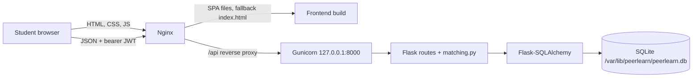
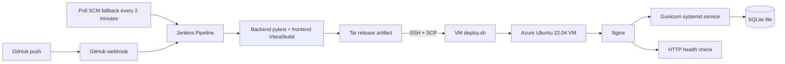

# Architecture

## Components and request flow

The browser serves a React single-page application built with Vite and Tailwind CSS. The UI sends JSON requests to `/api`; JWTs are held in browser local storage and sent as bearer tokens. On the VM, Nginx serves the built frontend and forwards `/api/` to Gunicorn, which hosts the Flask application. Flask uses SQLAlchemy to read and write the configured SQLite database file.

The matching module is separate from HTTP handling so its scoring rules can be tested directly. It selects users teaching the requested skill, removes the requester, applies an optional department filter, and scores mutual exchanges (+3), shared availability slots (+1 each), and same department (+1).

## CI/CD request flow

The same-VM Jenkins option is the assessment default. Its SSH target is `127.0.0.1`; the public VM IP remains the health-check URL. `VM_IP`, `VM_HOST`, and `VM_USER` are Jenkins environment properties. The SSH private key is stored as the Jenkins credential `azure-vm-ssh`.
